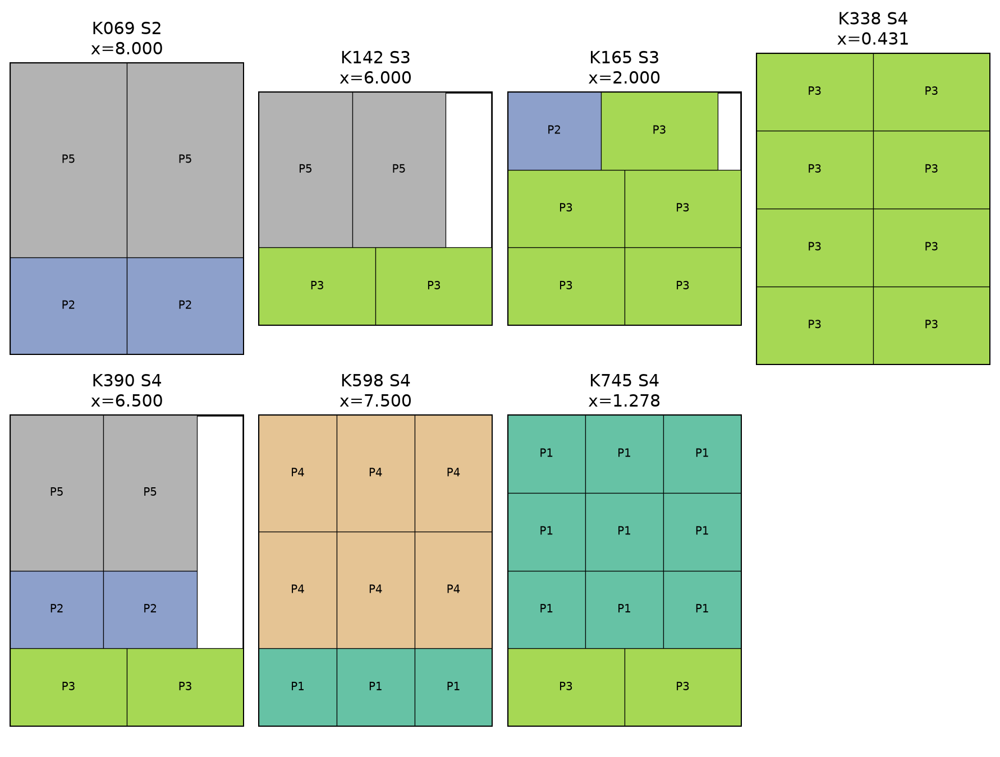
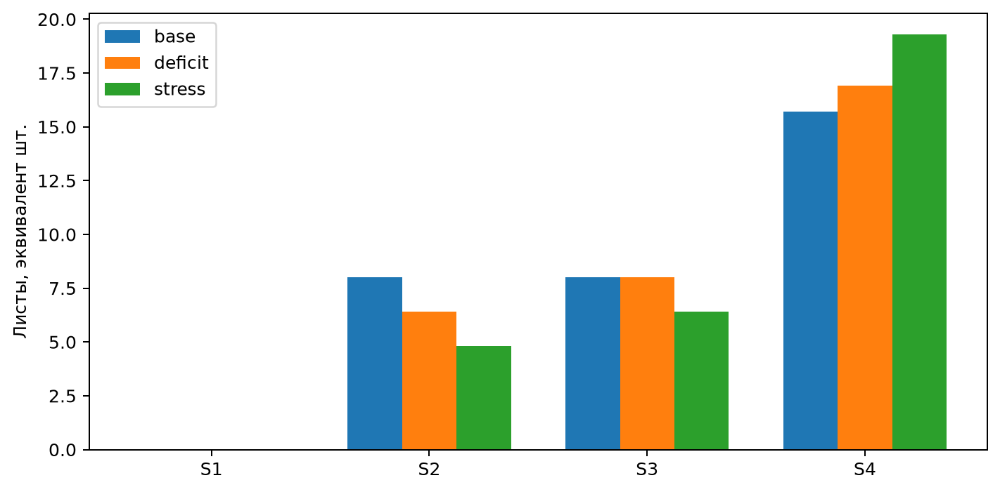

# Лабораторная работа № 1

ЛП-модель распределения ресурсов при раскрое листов

**Яковлев Иван · Б24-517 · № 28 · осенний семестр 2026 года**

Вариант 10; seed 10128.

## 1 Постановка и индивидуальный вариант

Работа выполнена для Яковлева Ивана, группа Б24-517, номер в группе N = 28. Для группы 517 индекс Q = 1. Год выполнения — 2026, осенний семестр, поэтому Y = 26.

```text
V = 1 + ((17·28 + 7·1 + 26) mod 20) = 1 + (509 mod 20) = 10
seed = 10000 + 100·1 + 28 = 10128
```

Исходные данные синтетические: методические указания задают тему и минимальный масштаб, но не содержат числового набора для варианта 10. Параметры и процедура генерации сохранены в data.json и функции generate_data в main.py. Модель отделена от данных. Дополнительные задания и задания со звёздочкой не выполнялись.

Цель — удовлетворить заказ на пять прямоугольных деталей, используя четыре типоразмера листа и минимизируя общую площадь расходуемого материала. Базовый оптимум: 79.525 м², в том числе 74.65 м² полезной площади и 4.875 м² отходов.

## 2 Данные и схемы раскроя

| Деталь | Ширина, мм | Высота, мм | Заказ, шт. |
| --- | --- | --- | --- |
| P1 | 500 | 500 | 34 |
| P2 | 600 | 500 | 31 |
| P3 | 750 | 500 | 41 |
| P4 | 500 | 750 | 45 |
| P5 | 600 | 1000 | 41 |

| Лист | Ширина, мм | Высота, мм | Доступно, шт. |
| --- | --- | --- | --- |
| S1 | 1000 | 1500 | 9 |
| S2 | 1200 | 1500 | 8 |
| S3 | 1500 | 1500 | 8 |
| S4 | 1500 | 2000 | 40 |

Спрос генерируется вызовом numpy.random.default_rng(10128).integers(25, 46) последовательно для P1–P5. Геометрия и исходные запасы заданы фиксированно в генераторе. Горизонт — один плановый период. Дробный эквивалент числа листов допустим в усреднённой ЛП-постановке.

Сгенерированы 753 схемы двухэтапного гильотинного раскроя: сначала лист делится на горизонтальные полосы, затем каждая полоса — на детали одной высоты. Для каждой высоты перечисляются все ненулевые сочетания деталей, помещающиеся по ширине; затем все неубывающие сочетания полос, помещающиеся по высоте. Повторяющиеся векторы выпуска одного типа листа удаляются. Схемы сохранены в patterns.json и patterns.csv; для каждой есть геометрическое описание полос.

Ориентация деталей фиксирована; повороты, ширина реза и дефекты материала не учитываются. Полосы со смешанной высотой деталей и негильотинные схемы не рассматриваются. Оптимальность относится к заявленному классу схем, а не ко всем возможным двумерным раскроям.

## 3 Формальная ЛП-модель

Множества: I — пять позиций заказа; S — четыре типа листов; K — библиотека допустимых схем; K(s) — схемы типа s. Параметры: dᵢ — заказ, шт.; aᵢₖ — число деталей i в схеме k, шт./лист; Bₛ — запас листов, шт.; Aₛ — площадь листа, м²/лист. Переменная xₖ ≥ 0 — эквивалент числа листов, раскраиваемых по схеме k, шт.

```text
min F = Σₖ Aₛ₍ₖ₎ xₖ
Σₖ aᵢₖ xₖ = dᵢ                      для каждой детали i
Σₖ∈K(s) xₖ ≤ Bₛ                      для каждого типа s
xₖ ≥ 0                               для каждой схемы k
```

Цель измеряется в м² за период. Равенства заказов запрещают перепроизводство. Полезная площадь U = Σᵢ widthᵢ·heightᵢ·dᵢ / 10⁶ постоянна, поэтому минимизация F эквивалентна минимизации отходов F − U. Полученная задача имеет 753 непрерывных переменных и 9 строк ограничений.

## 4 Базовый оптимальный план

| Схема | Лист | Листов | P1 | P2 | P3 | P4 | P5 |
| --- | --- | --- | --- | --- | --- | --- | --- |
| K069 | S2 | 8 | 0 | 2 | 0 | 0 | 2 |
| K142 | S3 | 6 | 0 | 0 | 2 | 0 | 2 |
| K165 | S3 | 2 | 0 | 1 | 5 | 0 | 0 |
| K338 | S4 | 0.4306 | 0 | 0 | 8 | 0 | 0 |
| K390 | S4 | 6.5 | 0 | 2 | 2 | 0 | 2 |
| K598 | S4 | 7.5 | 3 | 0 | 0 | 6 | 0 |
| K745 | S4 | 1.2778 | 9 | 0 | 2 | 0 | 0 |

Применяется 7 схем из 753; общий расход — 31.7083 эквивалентных листа. Заказ выпускается точно: P1: 34 шт., P2: 31 шт., P3: 41 шт., P4: 45 шт., P5: 41 шт. Коэффициент использования материала: 93.87%.



Нулевые значения имеют 746 схем: лишние схемы не нужны для выполнения точного заказа. У 689 из них приведённая стоимость строго положительна — локальное введение такой схемы ухудшает цель при текущих двойственных оценках. Нулевая приведённая стоимость у остальных допускает вырожденность или альтернативные оптимальные планы, но сама по себе не доказывает существование отличного плана. Все значения приведены в reduced_costs.csv.

## 5 Сценарии и теневые цены

Базовый сценарий использует исходные запасы. Дефицитный уменьшает запас S2 на 20%. Этот ресурс выбран автоматически по наиболее отрицательной теневой цене базового решения. Стрессовый уменьшает тот же запас на 40% и запас S3 на 20%. Все прочие данные неизменны.

| Сценарий | Площадь, м² | Отходы, м² | ΔF, м² | Прогноз ΔF |
| --- | --- | --- | --- | --- |
| base | 79.525 | 4.875 | 0 | 0 |
| deficit | 80.245 | 5.595 | 0.72 | 0.72 |
| stress | 80.965 | 6.315 | 1.44 | 1.44 |

| Ресурс | Использовано | Запас | Цена, м²/лист | ΔF при +0,01 |
| --- | --- | --- | --- | --- |
| S1 | 0 | 9 | 0 | 0 |
| S2 | 8 | 8 | -0.45 | -0.0045 |
| S3 | 8 | 8 | 0 | 0 |
| S4 | 15.7083 | 40 | 0 | 0 |

Первоочередной ресурс для увеличения — S2: его теневая цена -0.45 м²/лист. Это эффект замещения схем, а не уменьшение площади самого листа. При добавлении 0,01 листа фактическое изменение -0.0045 м² сравнивается с прогнозом -0.0045 м². Полное использование запаса не гарантирует полезности его расширения: у активного ограничения цена может быть нулевой.

Для обоих ухудшений линейный прогноз Σₛ λₛ·ΔBₛ совпал с фактическим изменением цели в пределах допуска. Это проверка для конкретных изменений; диапазон устойчивости базиса не вычислялся. Площадь и число листов — разные показатели: замена на более крупные листы может уменьшить их число при росте площади. Все три сценария Optimal, конфликтующих ограничений в них нет.

Расход типов листа S1–S4, эквивалент шт.: base — 0, 8, 8, 15.7083; deficit — 0, 6.4, 8, 16.9083; stress — 0, 4.8, 6.4, 19.3083. Полные планы схем всех сценариев приложены в *_solution.csv. Решения четырёх проверочных опытов увеличения запаса также независимо проверены.



## Независимая проверка

Функция verify получает исходные предметные данные и числовой вектор решения. Она не обращается к объекту HiGHS и не использует матрицу build_model: заново суммирует ресурсы, спрос и стоимость средствами NumPy и Python. Каждое ограничение проверяется с абсолютным допуском 10⁻⁷; цель пересчитывается отдельно. Полные построчные проверки сохранены в *_constraints.csv, итоги — в *_verification.json.

| Проверка | Допустимо | Макс. нарушение | Ошибка цели |
| --- | --- | --- | --- |
| base | да | 1.42e-14 | 1.42e-14 |
| deficit | да | 1.42e-14 | 1.42e-14 |
| stress | да | 7.11e-15 | 0.00e+00 |

В комплекте 7 файлов независимой проверки. Максимальное нарушение среди них — 1.42e-14; максимальная ошибка пересчёта цели — 1.42e-14. Некорректная длина вектора, NaN и бесконечные значения отклоняются до проверки ограничений.

Дополнительно для всей библиотеки заново проверяются сумма ширин деталей каждой полосы, равенство высот деталей высоте полосы, сумма высот полос и соответствие вектора выпуска геометрии. Проверены все схемы, включая неиспользуемые.

## Реализация и воспроизводимость

Python 3.12.14; HiGHS 1.15.1 через highspy; NumPy 2.3.5; Matplotlib 3.11.2. Версии зависимостей закреплены в requirements.txt. Вход — data.json; запуск — python main.py. Функции: generate_data, load_data, build_model, verify, main; общий интерфейс solve и файловая отчётность — common.py; оформление — reporting.py.

Для непрерывных задач выбран двойственный симплекс-метод. Presolve включён. Один поток, random_seed = 10128; лимит времени 120 с; primal_feasibility_tolerance и dual_feasibility_tolerance равны 10⁻⁸. Для MILP дополнительно mip_feasibility_tolerance = 10⁻⁸ и mip_rel_gap = 0; используется ветвление с отсечениями. Реальные журнал и LP-файл каждой задачи находятся в results. Время измерено perf_counter вокруг h.run, включая presolve, без генерации, записи файлов и построения рисунков.

Optimal означает подтверждённый солвером оптимум с учётом численных допусков. Infeasible означает отсутствие допустимого плана, Unbounded — неограниченность цели; Time limit требует отдельно рассматривать наличие допустимого решения и оценку зазора. Эти три статуса в основных экспериментах не получены. Программа прекращает обычное оформление при результате, отличном от Optimal, чтобы не выдать его за оптимальный.

Числа в таблицах отчёта округлены для чтения. Для воспроизведения плана и проверки допуска следует использовать CSV или JSON с полной точностью. Отдельные входные наборы сценариев сохранены в *_data.json. Регрессионные проверки запускаются командой python test_validation.py; обязательные проверки также действуют при python -O.

## Вывод и практическая реализуемость

План покрывает весь заказ при минимальной площади 79.525 м² в выбранной библиотеке схем; отходы составляют 4.875 м². Расширение запаса S2 следует оценивать в первую очередь по найденной теневой цене. Геометрия каждой схемы реализуема, однако дробное число листов требует усреднения по повторяющимся заказам. Для разовой производственной партии потребуются целые листы, припуски на рез, условия поворота, остатки и настройка станка; независимое округление переменных не гарантирует выполнения заказа и запасов. Целочисленное расширение не выполнялось.

## Источники

Кузьмин А. А. Методы оптимизации. Линейное программирование. Комплекс лабораторных работ. 2026. Индивидуальный вариант и обязательные требования взяты из предоставленного методического документа.

HiGHS Documentation. [Интерфейс Python](https://ergo-code.github.io/HiGHS/dev/interfaces/python/example-py/), [Параметры солвера](https://ergo-code.github.io/HiGHS/dev/options/definitions/). Дата обращения: 06.11.2026.
