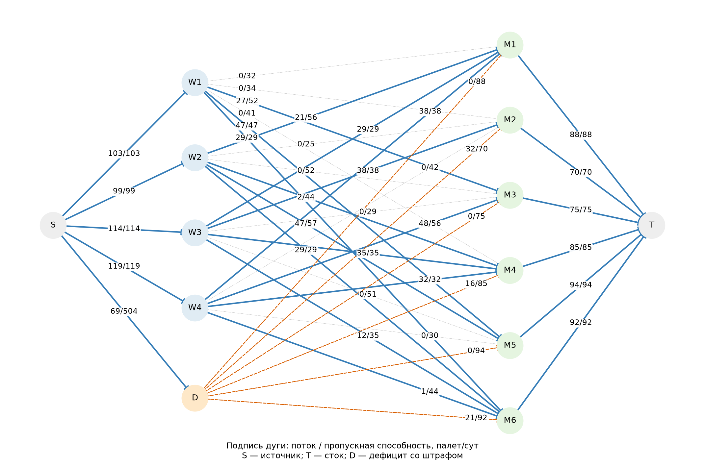
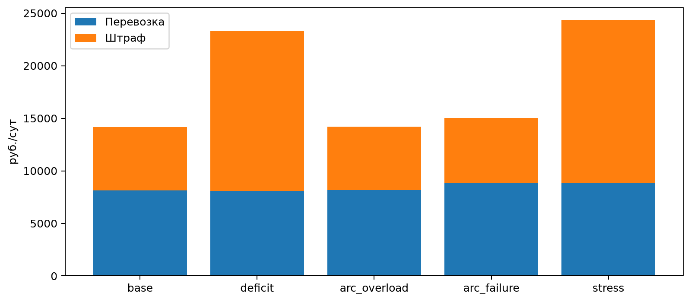

# Лабораторная работа № 2

Транспортная задача с дефицитом и штрафами

**Яковлев Иван · Б24-517 · № 28 · осенний семестр 2026 года**

Вариант 10; seed 10128.

## 1 Постановка и индивидуальный вариант

Работа выполнена для Яковлева Ивана, группа Б24-517, номер в группе N = 28. Для группы 517 индекс Q = 1. Год выполнения — 2026, осенний семестр, поэтому Y = 26.

```text
V = 1 + ((17·28 + 7·1 + 26) mod 20) = 1 + (509 mod 20) = 10
seed = 10000 + 100·1 + 28 = 10128
```

Исходные данные синтетические: методические указания задают тему и минимальный масштаб, но не содержат числового набора для варианта 10. Параметры и процедура генерации сохранены в data.json и функции generate_data в main.py. Модель отделена от данных. Дополнительные задания и задания со звёздочкой не выполнялись.

Решается транспортная задача для четырёх складов и шести магазинов за сутки. Цель — минимизировать стоимость перевозок и штраф за неудовлетворённый спрос с учётом ограничений маршрутов. Товар делим: единица — палета-эквивалент. Базовый оптимум равен 14146 руб./сут; 69 палет/сут спроса остаются неудовлетворёнными.

## 2 Данные и структура сети

| Склад | Запас, палет/сут | M1 | M2 | M3 | M4 | M5 | M6 |
| --- | --- | --- | --- | --- | --- | --- | --- |
| W1 | 103 | 43/32 | 36/34 | 23/52 | 32/41 | 10/47 | 13/29 |
| W2 | 99 | 32/56 | 36/25 | 32/52 | 28/44 | 29/57 | 19/29 |
| W3 | 114 | 22/29 | 12/38 | 39/29 | 12/35 | 40/51 | 35/35 |
| W4 | 119 | 17/38 | 25/42 | 16/56 | 20/32 | 44/30 | 31/44 |

В ячейках маршрутов указаны тариф / пропускная способность: руб./палету и палет/сут соответственно. Существуют все 24 направленные дуги склад → магазин.

| Магазин | M1 | M2 | M3 | M4 | M5 | M6 |
| --- | --- | --- | --- | --- | --- | --- |
| Спрос, палет/сут | 88 | 70 | 75 | 85 | 94 | 92 |
| Штраф, руб./палету | 98 | 85 | 96 | 84 | 123 | 93 |

Генератор — default_rng(10128). В указанном порядке выбираются целые равномерные значения: запасы [90,121), спрос [65,96), тарифы [8,46), ёмкости [25,61), штрафы [80,131). Правая граница исключается. Общий запас — 435, спрос — 504 палет/сут: дефицит не менее 69 палет/сут неизбежен даже без ограничений маршрутов.

Для потоковой интерпретации вводятся общий источник S, фиктивный поставщик D и сток T. Дуги S→W имеют ёмкости запасов и нулевые тарифы; W→M — транспортные маршруты; S→D имеет ёмкость суммарного спроса; D→M — дефицит со штрафным тарифом; M→T несут фиксированный спрос. В явной ЛП используются 30 переменных, дополнительные потоки восстанавливаются из них. Полная сеть с потоками, ёмкостями и тарифами сохранена в *_network_arcs.csv.

## 3 Формальная ЛП-модель

I — четыре склада, J — шесть магазинов. sᵢ — запас, dⱼ — спрос, uᵢⱼ — ёмкость маршрута (палет/сут); cᵢⱼ — транспортный тариф и pⱼ — штраф (руб./палету). Непрерывные переменные xᵢⱼ — доставка, zⱼ — неудовлетворённый спрос (палет/сут).

```text
min F = ΣᵢΣⱼ cᵢⱼ xᵢⱼ + Σⱼ pⱼ zⱼ
Σⱼ xᵢⱼ ≤ sᵢ                            для каждого склада i
Σᵢ xᵢⱼ + zⱼ = dⱼ                       для каждого магазина j
0 ≤ xᵢⱼ ≤ uᵢⱼ;  0 ≤ zⱼ ≤ dⱼ
```

F измеряется в руб./сут. Штраф — экономическая оценка потери сервиса, а не реальная доставка. Наличие z гарантирует допустимость при любых неотрицательных входных данных: можно выбрать x = 0, z = d. Это не означает приемлемого качества обслуживания. Модель предполагает один товар, линейные тарифы и отсутствие фиксированной цены рейса, времени в пути и неделимых автомобилей.

## 4 Базовый план и сеть

| Поток, палет/сут | M1 | M2 | M3 | M4 | M5 | M6 | Итого |
| --- | --- | --- | --- | --- | --- | --- | --- |
| W1 | 0 | 0 | 27 | 0 | 47 | 29 | 103 |
| W2 | 21 | 0 | 0 | 2 | 47 | 29 | 99 |
| W3 | 29 | 38 | 0 | 35 | 0 | 12 | 114 |
| W4 | 38 | 0 | 48 | 32 | 0 | 1 | 119 |
| Дефицит | 0 | 32 | 0 | 16 | 0 | 21 | 69 |

Перевозки стоят 8129 руб./сут, штрафы — 6017 руб./сут. Использовано 435 из 435 палет запасов; 69 палет спроса не покрываются. Распределение дефицита определяется штрафом и доступными маршрутами. Нулевые потоки означают, что эти направления не нужны в выбранном оптимальном плане.



На рисунке показаны все 13 узлов и 41 дуга расширенной сети, включая общий источник S и сток T. Для каждой дуги подписаны поток / ёмкость. Нулевые транспортные потоки обозначены пунктиром, дуги штрафного дефицита — оранжевым штрихом. Тарифы приведены в таблице данных и сетевом CSV.

## 5 Сценарии и жадная эвристика

Самая загруженная по абсолютному потоку дуга — W4→M3, 48 палет/сут из 56. При равенстве выбирается первая по индексам. Дефицитный сценарий увеличивает весь спрос на 20%; перегрузка уменьшает ёмкость выбранной дуги на 20%; отказ закрывает её полностью; стресс одновременно увеличивает спрос на 20% и закрывает эту дугу.

| Сценарий | Цель, руб./сут | Дефицит | Ущерб, руб./сут | Зазор жадного, % |
| --- | --- | --- | --- | --- |
| base | 14146 | 69 | 0 | 2.46 |
| deficit | 23302.4 | 169.8 | 9156.4 | 6.231 |
| arc_overload | 14187.6 | 69 | 41.6 | 1.3 |
| arc_failure | 15036 | 69 | 890 | 1.317 |
| stress | 24306.4 | 169.8 | 10160.4 | 5.184 |

При росте спроса дефицит меняется с 69 до 169.8 палет/сут, стоимость растёт на 9156.4 руб./сут. Отказ наиболее загруженной дуги увеличивает цель на 890 руб./сут; дефицит составляет 69 палет/сут. Поток перераспределяется, меняются транспортная стоимость и распределение потерь между магазинами. Совместный стресс даёт 24306.4 руб./сут. Дополнительный ущерб отказа при повышенном спросе равен 1004 руб./сут, поэтому эффекты не обязаны складываться линейно.

Жадная эвристика сортирует маршруты по тарифу и последовательно отправляет минимум остатка запаса, остатка спроса и ёмкости; маршруты дороже штрафа пропускаются. Неисполненный спрос становится дефицитом. Эвристика допустима и проверяется тем же независимым кодом, но не пересматривает ранние решения и не учитывает альтернативные издержки маршрутов. Зазор = 100·(Fgreedy − Fopt)/Fopt.

| Сценарий | Оптимум | Жадный | HiGHS, мс | Жадный, мс |
| --- | --- | --- | --- | --- |
| base | 14146 | 14494 | 18.886 | 0.38 |
| deficit | 23302.4 | 24754.4 | 3.162 | 0.397 |
| arc_overload | 14187.6 | 14372 | 2.168 | 0.343 |
| arc_failure | 15036 | 15234 | 3.838 | 0.31 |
| stress | 24306.4 | 25566.4 | 3.036 | 0.286 |

В базе жадный план стоит 14494 руб./сут, что на 348 руб./сут (2.46%) хуже оптимума. В 5 из 5 запусков он быстрее на данном компьютере; эти времена — измерения единичных запусков, а не статистический бенчмарк.



## 6 Узкие места и двойственная интерпретация

| Дуга | Поток = ёмкость | Цена, руб./палету | ΔF при +0,01 |
| --- | --- | --- | --- |
| W1→M5 | 47 | -20 | -0.2 |
| W1→M6 | 29 | -25 | -0.25 |
| W2→M6 | 29 | -18 | -0.18 |
| W3→M1 | 29 | -8 | -0.08 |
| W3→M2 | 38 | -15 | -0.15 |
| W3→M4 | 35 | -14 | -0.14 |
| W4→M1 | 38 | -9 | -0.09 |
| W4→M4 | 32 | -2 | -0.02 |

Для ограничений склада αᵢ — row_dual строки запаса, βⱼ — row_dual баланса магазина. Приведённая стоимость дуги rᵢⱼ = cᵢⱼ − αᵢ − βⱼ. Если положительный поток достиг верхней границы, отрицательное rᵢⱼ показывает локальное уменьшение цели при увеличении её ёмкости на единицу. Максимальный локальный выигрыш среди насыщенных дуг даёт W1→M6: цена -25 руб./палету. Для каждой насыщенной дуги ёмкость отдельно увеличена на 0,01. Прогноз и факт приведены в bottlenecks.csv; все проверочные решения также прошли независимую проверку.

Самый большой поток и самая дорогая потеря пропускной способности — разные признаки. У самой загруженной W4→M3 поток 48 ниже ёмкости 56; резерв составляет 8 палет/сут. Первое небольшое уменьшение ёмкости в пределах резерва не меняет оптимум. Большой отказ выходит за локальный диапазон двойственной оценки. Значения всех узловых оценок сохранены в node_prices.csv.

## Независимая проверка

Функция verify получает исходные предметные данные и числовой вектор решения. Она не обращается к объекту HiGHS и не использует матрицу build_model: заново суммирует ресурсы, спрос и стоимость средствами NumPy и Python. Каждое ограничение проверяется с абсолютным допуском 10⁻⁷; цель пересчитывается отдельно. Полные построчные проверки сохранены в *_constraints.csv, итоги — в *_verification.json.

| Проверка | Допустимо | Макс. нарушение | Ошибка цели |
| --- | --- | --- | --- |
| base | да | 0.00e+00 | 0.00e+00 |
| deficit | да | 1.42e-14 | 0.00e+00 |
| arc_overload | да | 0.00e+00 | 0.00e+00 |
| arc_failure | да | 0.00e+00 | 0.00e+00 |
| stress | да | 0.00e+00 | 0.00e+00 |
| base_greedy | да | 0.00e+00 | 0.00e+00 |

В комплекте 18 файлов независимой проверки. Максимальное нарушение среди них — 1.42e-14; максимальная ошибка пересчёта цели — 1.82e-12. Некорректная длина вектора, NaN и бесконечные значения отклоняются до проверки ограничений.

Проверяются балансы всех 13 узлов расширенной сети S, D, W1–W4, M1–M6, T; на источнике и стоке учитывается внешний поток ±Σd. Границы проверяются на каждой из 41 дуги. Балансы вынесены в *_node_balances.csv. Проверены также все пять жадных планов, включая пересчёт их стоимости.

## Реализация и воспроизводимость

Python 3.12.14; HiGHS 1.15.1 через highspy; NumPy 2.3.5; Matplotlib 3.11.2. Версии зависимостей закреплены в requirements.txt. Вход — data.json; запуск — python main.py. Функции: generate_data, load_data, build_model, verify, main; общий интерфейс solve и файловая отчётность — common.py; оформление — reporting.py.

Для непрерывных задач выбран двойственный симплекс-метод. Presolve включён. Один поток, random_seed = 10128; лимит времени 120 с; primal_feasibility_tolerance и dual_feasibility_tolerance равны 10⁻⁸. Для MILP дополнительно mip_feasibility_tolerance = 10⁻⁸ и mip_rel_gap = 0; используется ветвление с отсечениями. Реальные журнал и LP-файл каждой задачи находятся в results. Время измерено perf_counter вокруг h.run, включая presolve, без генерации, записи файлов и построения рисунков.

Optimal означает подтверждённый солвером оптимум с учётом численных допусков. Infeasible означает отсутствие допустимого плана, Unbounded — неограниченность цели; Time limit требует отдельно рассматривать наличие допустимого решения и оценку зазора. Эти три статуса в основных экспериментах не получены. Программа прекращает обычное оформление при результате, отличном от Optimal, чтобы не выдать его за оптимальный.

Числа в таблицах отчёта округлены для чтения. Для воспроизведения плана и проверки допуска следует использовать CSV или JSON с полной точностью. Отдельные входные наборы сценариев сохранены в *_data.json. Регрессионные проверки запускаются командой python test_validation.py; обязательные проверки также действуют при python -O.

## Вывод и практическая реализуемость

ЛП определяет экономически наименее дорогой способ распределения дефицитного товара. Разница исходного спроса и запаса составляет 69 палет/сут; штрафная постановка даёт допустимый оптимум даже при нехватке товара. В первую очередь следует рассматривать увеличение запасов и снятие экономически значимых ограничений маршрутов, сопоставляя эффект с реальной ценой расширения. Для внедрения нужны ограничения минимального уровня обслуживания, размеры партий, доступность транспорта, сроки и достоверные оценки штрафов. Дробные палеты в сценариях интерпретируются как усреднённые объёмы.

## Источники

Кузьмин А. А. Методы оптимизации. Линейное программирование. Комплекс лабораторных работ. 2026. Индивидуальный вариант и обязательные требования взяты из предоставленного методического документа.

HiGHS Documentation. [Интерфейс Python](https://ergo-code.github.io/HiGHS/dev/interfaces/python/example-py/), [Параметры солвера](https://ergo-code.github.io/HiGHS/dev/options/definitions/). Дата обращения: 06.11.2026.
